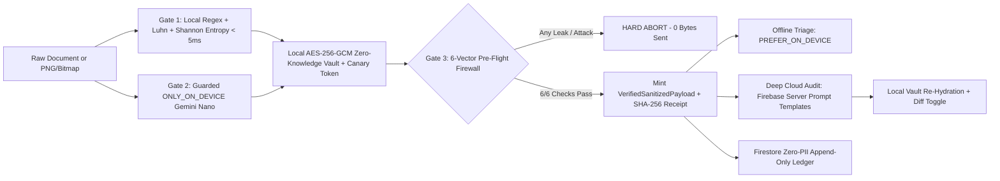

# AirlockAI

**Zero-Leakage Hybrid Document & Multimodal Auditor (Web PWA, Chrome Side Panel Extension, and Native Android)**

[](./LICENSE)
[](https://airlockai-2026-alex.web.app)
[](./packages/core/src/firewall.test.ts)

AirlockAI is a multi-platform hybrid AI security appliance built for **#BuildHybridAI 2026**. It lets professionals audit sensitive NDAs, HIPAA medical bills, and vendor wire invoices using cloud Gemini reasoning **without raw PII, secrets, or document pixels ever leaving the user's device**.

- **Live Web PWA:** https://airlockai-2026-alex.web.app
- **Devpost Project:** https://devpost.com/software/airlockai
- **Shared Cross-Platform Protocol Spec:** [`spec/vectors.json`](./spec/vectors.json) (`airlock.v1`)

---

## Why AirlockAI Exists

Prompting an on-device model with *"Please remove PII"* is probabilistic and trivially breakable via missed entities, reformatted digits, Unicode homoglyphs, Base64 exfiltration, or prompt injection. AirlockAI replaces best-effort prompting with a **4-layer deterministic + cryptographic security boundary** shared across Web, Chrome Extension, and Android:



---

## 4-Layer Zero-Leakage Architecture

1. **Layer 1: Compile-Time Branded Boundary (TypeScript & Kotlin)**
   - In TypeScript (`RawDocument` vs `VerifiedSanitizedPayload` in `packages/core/src/types.ts`) and Kotlin (`@JvmInline value class RawDocument` vs `internal constructor` `VerifiedSanitizedPayload` in `apps/android/.../AirlockTypes.kt`), cloud inference adapters **refuse to compile** if passed unverified text.
2. **Layer 2: Dual-Gate On-Device Scanner + SDK `#10635` Guard**
   - **Gate 1 (Deterministic, < 5 ms):** Algorithmic Luhn validation for 13-19 digit cards, Shannon-entropy secret scanning (>= 4.0 bits/char plus `sk-`, `AIza`, `ghp_` prefixes), IBAN, SSN, email, phone, currency, and dates.
   - **Gate 2 (`InferenceMode.ONLY_ON_DEVICE`):** Gemini Nano extracts contextual entities (`PERSON`, `ORG`, `MEDICAL`, `SECRET_TERM`) and transcribes local PNG/JPEG/Bitmap images strictly on-device.
   - **Pre-SDK `#10635` Runtime Guard:** Before invoking Firebase JS SDK `ONLY_ON_DEVICE`, AirlockAI verifies `LanguageModel.availability() === "available"` directly so unsupported browsers can never silently fall back to cloud endpoints with raw PII.
   - **Local Canvas Pixel Redaction:** Document images receive black redaction overlays locally on HTML5 Canvas; raw pixels never cross the wire.
3. **Layer 3: 6-Vector Adversarial Pre-Flight Firewall (Gate 3)**
   - Every outbound staging buffer is verified against all local vault secrets across six leak vectors:
     1. Exact and case-insensitive substring matches
     2. Punctuation/whitespace-collapsed alphanumeric matches (`912-45-6789` -> `912456789`)
     3. Partial-token / surname and trailing-6-digit leakage
     4. Encoded exfiltration (Base64, Hex, URL-encoded secrets)
     5. Unicode NFKC homoglyph and zero-width character (`\u200B`) smuggling
     6. Per-session synthetic **Canary Token Trap** against prompt injection
   - Passing 6/6 checks mints a tamper-evident, hash-chained **SHA-256 Airlock Attestation Receipt** (`rawDocSha256`, `sanitizedPayloadSha256`, `prevReceiptSha256`, `receiptSha256`).
4. **Layer 4: AES-256-GCM Local Vault + Server-Side Zero-PII Firestore Rules**
   - Reversible token mappings stay strictly on-device encrypted via AES-256-GCM (WebCrypto / JCA).
   - [`firestore.rules`](./firestore.rules) enforces an append-only audit ledger (`allow update, delete: if false`) with server-side `hasNoRawPii(...)` regex assertions that reject any write containing raw emails, SSNs, or 16-digit card numbers.

---

## Firebase Production Stack

| Firebase Capability | Role in AirlockAI |
|---|---|
| **Firebase AI Logic (`ONLY_ON_DEVICE`)** | Guarded Gate 2 semantic & multimodal PII scanner on Chrome Nano and Android (`OnDeviceModelOption.PREVIEW`) |
| **Firebase AI Logic (`PREFER_ON_DEVICE`)** | Offline-first document triage with `gemini-3.5-flash-lite` cloud fallback and live `inferenceSource` telemetry |
| **Server Prompt Templates** | Locked, versioned cloud audit instructions (`airlock-nda-v1-0-0`, `airlock-hipaa-v1-0-0`, `airlock-invoice-v1-0-0`) |
| **Firebase Remote Config** | Live compliance policy switch (`airlock_policy`: `NDA_STRICT`, `MEDICAL_HIPAA`, `INVOICE_FINANCE`) |
| **Firebase App Check** | Fraud Defense (`ReCaptchaEnterpriseProvider`) on Web, MV3-safe `CustomProvider` on Extension, Play Integrity / Debug on Android |
| **Anonymous Auth + Firestore** | Owner-scoped, hash-chained SHA-256 Audit Ledger synchronized across Web, Extension, and Android |
| **Firebase Hosting** | Production Web PWA at `https://airlockai-2026-alex.web.app` |

---

## Monorepo Structure

```text
airlockai/
├── spec/vectors.json                     # Canonical cross-platform golden vectors (TS + Kotlin)
├── packages/core/                        # Shared zero-dependency TS cryptographic firewall + proofs
├── apps/web/                             # Vite + React Web PWA with Live Wire Tap & Red-Team Lab
├── apps/extension/                       # Manifest V3 Chrome Side Panel Extension (reuses @airlock/core)
├── apps/android/                         # Native Kotlin + Jetpack Compose + Firebase AI Logic Android app
├── firestore.rules                       # Defense-in-depth zero-PII append-only Firestore security rules
├── firebase.json                         # Firebase Hosting + Firestore rules config
├── scripts/pre-submission-audit.sh       # Automated security, license, build, and test verification
└── .github/workflows/ci.yml              # Multi-platform CI (Vitest, fast-check, Vite, Kotlin JUnit)
```

---

## Quick Start & Verification

### 1. Run Cryptographic & Golden Parity Proofs (TypeScript)
```bash
npm install
npm run build:core
npm run test:core
```
Expected result: **14/14 Vitest tests passing** (10 cross-platform `spec/vectors.json` parity checks + 4 security suite tests including the **1,000-run `fast-check`** zero-leak property proof).

### 2. Run the Web PWA Locally
```bash
cp apps/web/.env.example apps/web/.env.local
# Add your Firebase Web App config and reCAPTCHA Enterprise (Fraud Defense) site key
npm run dev --workspace=@airlock/web
```
Build for production:
```bash
npm run build --workspace=@airlock/web
```

### 3. Build & Load the Chrome Side Panel Extension (MV3)
```bash
npm run build:extension
```
1. Open `chrome://extensions` and enable **Developer mode**.
2. Click **Load unpacked** and select `apps/extension/dist`.
3. Highlight sensitive text on any webpage and right-click **AirlockAI: Scrub & Audit Selection**.

### 4. Verify Native Android Kotlin Parity
```bash
cd apps/android
gradle testDebugUnitTest
```
`AirlockGoldenVectorParityTest.kt` runs the exact same [`spec/vectors.json`](./spec/vectors.json) file against the Kotlin firewall without requiring private Firebase credentials. To connect live Firebase on an Android device, place your `google-services.json` (git-ignored) in `apps/android/app/`.

### 5. Run the Pre-Submission Audit Script
```bash
./scripts/pre-submission-audit.sh
```

---

## License

Licensed under the [Apache License, Version 2.0](./LICENSE).
